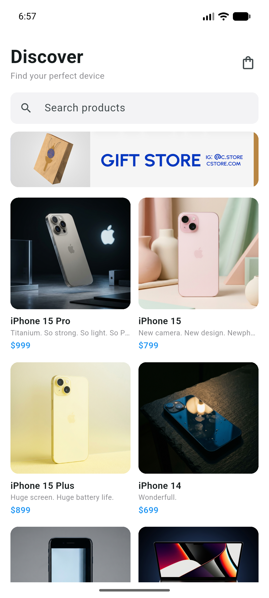
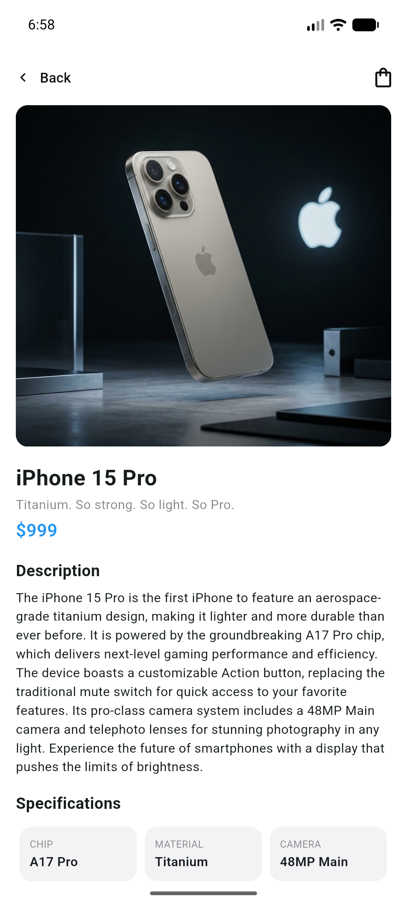
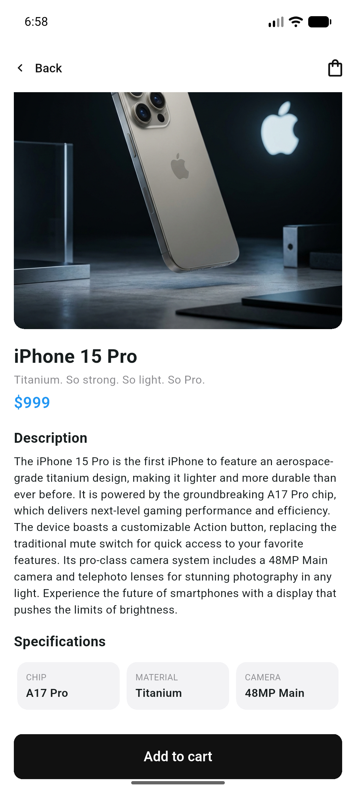
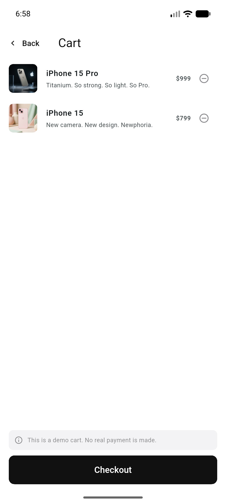
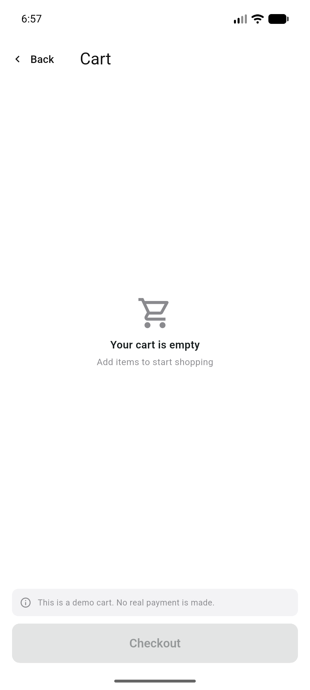

# Mini Katalog

Flutter ile geliştirilmiş, Android için basit ve profesyonel görünümlü bir ürün katalog uygulaması. Eğitim projesi kapsamında yalnızca Flutter'ın varsayılan `material.dart` kütüphanesiyle (ekstra paket kullanılmadan) yazılmıştır.

## Özellikler

- **Discover (ana sayfa):** banner, arama kutusu ve 2 sütunlu `GridView` ürün kartları
- **Ürün detayı:** görsel, açıklama ve teknik özellikler, "Add to cart" butonu
- **Sepet:** ürün ekleme/çıkarma, sepet rozeti, boş sepet ekranı, demo Checkout
- **Arama:** ürün adı ve sloganına göre anlık filtreleme
- **Navigasyon:** Named Routes ve Route Arguments ile ürün taşıma
- **Veri:** ürünler API'den okunur, internet yoksa `assets/data/products.json` kullanılır

Platform: **Android** (Android Studio emülatöründe ve release APK olarak doğrulandı).

## Kullanılan Flutter sürümü

- Flutter **3.47.9** (stable)
- Dart **3.13.7**

## Çalıştırma adımları

1. Flutter SDK'yı kurun: https://docs.flutter.dev/get-started/install
2. Android Studio'dan bir Android emülatör oluşturun veya fiziksel cihaz bağlayın.
3. Depoyu klonlayın:
   ```bash
   git clone https://github.com/sonmez9/mini_katalog.git
   cd mini_katalog
   ```
4. Bağımlılıkları yükleyin ve çalıştırın:
   ```bash
   flutter pub get
   flutter run
   ```

## Testler

```bash
flutter analyze
flutter test
```

Testler sepet mantığını ve ana akışı (listeleme, arama, detay, sepete ekleme, silme, Checkout) kapsar.

## Proje yapısı

```
lib/
  main.dart                 # Uygulama girişi ve route tanımları
  models/product.dart       # Product modeli (fromJson / toJson)
  services/product_service.dart  # API okuma (dart:io HttpClient) + asset yedeği
  state/cart_state.dart     # Sepet durumu (ChangeNotifier + InheritedNotifier)
  theme/app_theme.dart      # Basit UI teması
  screens/                  # home, detail, cart ekranları
  widgets/                  # product_card, product_image
assets/
  data/products.json        # Çevrimdışı yedek veri
  images/banner.png         # Çevrimdışı yedek banner
```

## Veri kaynakları

Eğitim ve demo amaçlıdır, gerçek bir e-ticaret altyapısını temsil etmez.

- Ürünler: https://wantapi.com/products.php
- Banner: https://wantapi.com/assets/banner.png

## Ekran görüntüleri

| Discover | Ürün detayı | Özellikler |
|---|---|---|
|  |  |  |

| Sepet | Boş sepet |
|---|---|
|  |  |
